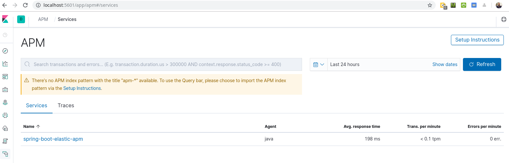
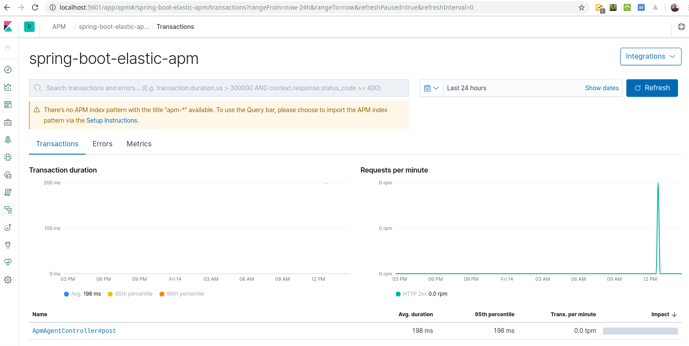
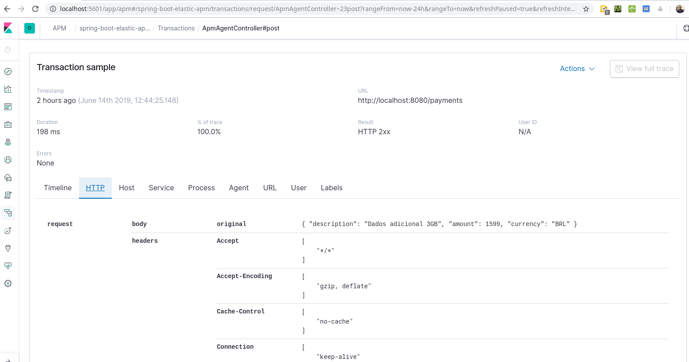

# Spring Boot Elastic APM

[](https://github.com/hendisantika/springboot-elastic-apm/actions/workflows/maven.yml)


Sample Spring Boot application with some config files for a POC of the Elastic APM Stack.

## Tech Stack

| Component            | Version                         |
|----------------------|---------------------------------|
| Java (JDK)           | **25** (Temurin in CI)          |
| Spring Boot          | 4.1.x                           |
| Maven                | 3.10.x (via Maven Wrapper)      |
| Lombok               | 1.18.x                          |
| Elastic APM Server   | 7.1.1 (Docker)                  |
| Elasticsearch/Kibana | 7.1.1 (Docker)                  |

## Prerequisites

- JDK 25 (`java -version` should report `25`)
- Docker & Docker Compose
- (Optional) Maven 3.9+ — or just use the bundled `./mvnw`

## Build

```shell
./mvnw clean package
```

The jar is generated at `target/elastic-apm-0.0.1-SNAPSHOT.jar`.

## Run the Elastic APM POC

1. Download the Elastic APM attach library `apm-agent-attach` from
   [Maven Central](https://central.sonatype.com/artifact/co.elastic.apm/apm-agent-attach).
   Alternatively, download `elastic-apm-agent` and start the app with `-javaagent` as shown in `install-agent.sh`
   (adjust the paths inside the script first).
2. Start the containers (APM Server, Elasticsearch & Kibana)

   ```shell
   docker compose up
   ```

   Alternative stacks are also available: `docker-compose-logstash.yml` and `docker-compose-kafka.yml`.

3. Run the application

   ```shell
   java -jar target/elastic-apm-0.0.1-SNAPSHOT.jar
   ```

   > Spring Boot's Docker Compose support (`spring-boot-docker-compose`) will also start `compose.yaml`
   > automatically when you run the app with `./mvnw spring-boot:run`.

4. Get the PID of the application (e.g. `jps -l`)
5. Attach the agent (_more about configs: https://www.elastic.co/guide/en/apm/agent/java/current/intro.html_)

   ```shell
   java -jar apm-agent-attach-<version>.jar --pid <pid> --config 'capture_body=all'
   ```

6. Open Kibana (http://localhost:5601)
7. Go to the "APM" item of the left menu
8. The name of the application will be displayed, click on it
   
9. Some monitoring data will be displayed
   
10. Send some requests

    ```shell
    curl -X POST \
      http://localhost:8080/payments/json \
      -H 'Content-Type: application/json' \
      -H 'X-Organization: zup' \
      -d '{
      "description": "Jujutsu Kaisen",
      "amount": 1500,
      "currency": "IDR",
      "creditCard": {
        "type": "MASTERCARD",
        "number": "5568392674344894"
      },
      "customer": {
        "cpf": "39782928070",
        "name": "John Doo"
      }
    }'
    ```

11. Some seconds later the HTTP request will be displayed
    

## Continuous Integration

GitHub Actions workflow [`.github/workflows/maven.yml`](.github/workflows/maven.yml):

- Runs on every push / pull request to `main` (and manually via `workflow_dispatch`).
- Sets up **Temurin JDK 25** with Maven dependency caching and runs `mvn -B package` (compile + tests).
- On pushes to `main`, submits the Maven dependency graph to GitHub to improve Dependabot alerts
  (non-blocking — the build stays green even if the Dependency graph is disabled).

## Dependabot

Configured in [`.github/dependabot.yml`](.github/dependabot.yml):

| Ecosystem        | Schedule (Asia/Jakarta)  | Grouping                                                             |
|------------------|--------------------------|----------------------------------------------------------------------|
| `maven`          | Daily, 05:00             | `spring-boot`, `lombok`, `maven-plugins`, `test-dependencies`        |
| `github-actions` | Weekly (Monday), 05:00   | all actions in one PR                                                |
| `docker-compose` | Weekly (Monday), 05:00   | `elastic-stack` (major bumps ignored — configs are for Elastic 7.x)  |

PRs are labeled (`dependencies`, `java`, `github-actions`, `docker`), assigned to the maintainer, and use
conventional commit prefixes (`chore(deps)`, `ci(deps)`, `chore(docker)`).
